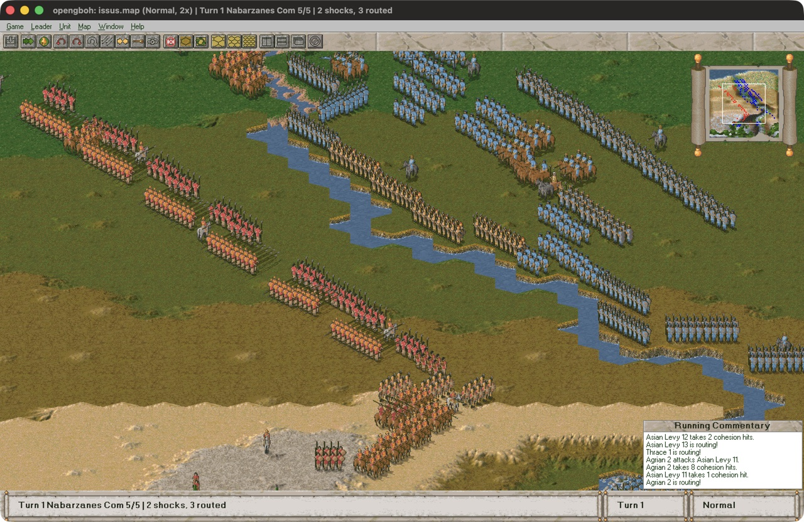
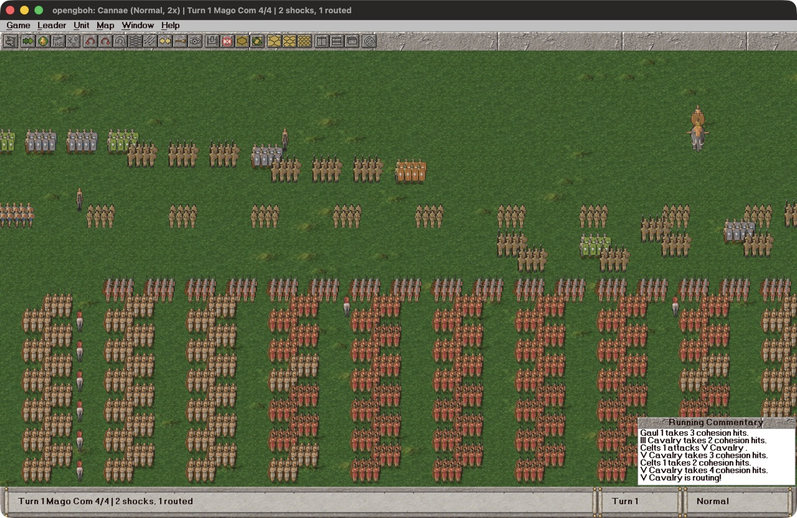
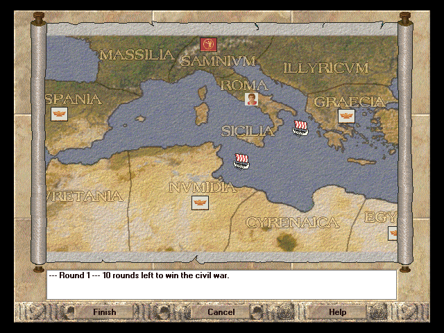
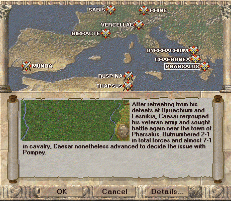
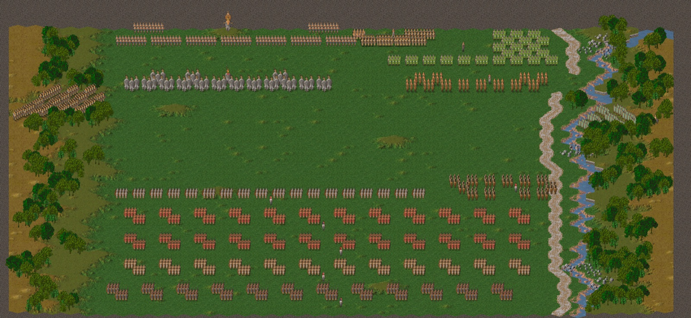

# opengboh

An open-source reimplementation, written in Rust, of the Erudite Software engine
behind the *Great Battles of History* (GBoH) series of computer games:

| game | state |
|---|---|
| *The Great Battles of Alexander* (1997) | playable: all battles, the campaign, the AI |
| *The Great Battles of Hannibal* (1997) | playable: its own rules, battles, campaign and AI |
| *The Great Battles of Caesar* (1998) | playable: its own rules, battles, campaign and AI |

**This repository contains no game data.** You need your own copy of the
games (the GOG releases work); opengboh reads the original files from them.
Prebuilt programs for macOS, Windows and Linux are on the
[Releases](https://github.com/fmestevez/opengboh/releases) page.



| | |
|---|---|
|  |  |
|  |  |

*Screenshots of opengboh running with the original games' data: Issus;
Cannae; Caesar's civil war campaign and battle selection; a Collector's
Edition scenario mixing the three games' armies.*

## Status

All three games can be played from start to finish: every battle, the
campaigns, the computer opponent (the games' own AI scripts), hot-seat and
network play, saved games. The rules are rebuilt from the original
executables and checked against the originals running under Wine; the
battlefield is drawn by a software renderer checked pixel by pixel against
them.

Where the original code is known to be buggy, opengboh fixes it; where a
fix would change the balance, or where the manuals describe rules the code
never applied, there are rule options instead (see below). A few details
are still approximations; `docs/formats.md` marks them 🟡.

In progress or missing:

* a scenario editor (after the *Collector's Edition* one, with every unit
  and nation of the three games), and playing the *Collector's Edition*
  scenarios it makes;
* some rules the manuals describe without the numbers to implement them,
  and the manuals' printed combat tables as an option;
* opengboh is developed and tested on macOS; it should build on Windows and
  Linux (it uses `wgpu` and `winit`) but isn't tested there yet.

## Getting started

Install a stable [Rust](https://rustup.rs) toolchain, then:

```sh
cargo run --release -p gboh-viewer
```

`opengboh` opens on its **content manager**: for each of the three games,
**Import…** asks for the folder where you installed it and copies its
executable and data into opengboh's own directory (**Re-import** copies
it again). Nothing else is written anywhere, and opengboh carries no data
of its own. Once a game is imported, **Continue** opens its start screen,
with three buttons of opengboh's own:

* **Content Manager**;
* **Settings**: the theme (whose intro, start screen and art the menus
  use), the game's preferences, and the **Rules** (below);
* **All Battles**: every imported game's battles and campaigns in one
  list.

The rest of the start screen is the game's own: Start Battle, Start
Campaign, Multiplayer, Load Saved Game, the tutorial.

## Playing

The battle window follows the original's: toolbar, menus with their
accelerators, status bar, overview map, running commentary, unit details,
combat results, the game overview at the end of each turn, and the victory
or defeat screen. The screens use the games' own art, and their text and
layouts are read from the games' executables. Sound and music are the
games' own (Hannibal's and Caesar's CD music from the GOG releases'
`MUSIC` folders).

* Select one of the active leader's units (they carry his flag) to light
  the hexes it can reach; click a lit hex to move, an enemy in front to
  designate a shock; right-click an enemy to volley. Q/E turn the unit, R
  rallies it, C recovers its cohesion.
* Click the active leader, then a lit hex, to move him; G tries a group
  move. Hannibal's and Caesar's group orders, line extension and backward
  movement are on the toolbar and in the menus.
* Enter finishes the leader (his shocks are fought, and you may try for
  momentum); M finishes him and tries for momentum. Ctrl+Z undoes the last
  unit's move or turn.
* The mouse pointer is the game's own: an arrow at the edges scrolls, a
  sword over an enemy you can shock, a missile over one you can shoot.
  Arrows/WASD, dragging and the wheel scroll too; 1/2/3 zoom.
* Ctrl+S (Cmd+S) saves, Ctrl+L loads; games autosave each turn. Saves go to
  `~/Library/Application Support/opengboh/saves` on macOS,
  `%APPDATA%\opengboh\saves` on Windows and `~/.local/share/opengboh/saves`
  elsewhere (`GBOH_SAVES` overrides it). They replay exactly.

**Multiplayer** links two copies of opengboh over TCP (port 5000): one
creates the game and chooses the battle, the other joins by its name or
address.

## Rule options

Settings → **Rules** turns on, for new battles:

* the manuals' rules where the games' code differs: turning costs, shock
  combat (terrain shifts, the charge, size ratio, leaders), missiles,
  movement through zones of control, command, and victory conditions;
* rules of one game in another: Hannibal's cavalry pursuit, deployment
  phase, backward movement and group orders for Alexander; Caesar's road
  movement, rally penalties and staff leaders for Alexander and Hannibal,
  and its superiority rule for Hannibal.

All are off by default: the games as they shipped, their plain bugs fixed.
Saves record the options their battle was fought by, and in a network game
the host's options apply to both players.

## For developers

The workspace's crates:

* `gboh-formats`: the games' file formats (EIF sprites, palettes, maps,
  scenarios, the executables' resources, the help files);
* `gboh-render`: the battlefield renderer;
* `gboh-game`: the rules, independent of rendering (battle state,
  activation, movement, combat, routs, the AI script interpreter,
  campaigns, rule options);
* `gboh-viewer`: the `opengboh` program;
* `gboh-tools`: command-line tools.

The viewer also opens a data folder directly, and `gboh-tools` renders,
inspects and plays battles without a window:

```sh
cargo run --release -p gboh-viewer -- "/path/to/game/DATA" GRANICUS.SCN      # a battle, hot seat
cargo run --release -p gboh-viewer -- "/path/to/game/DATA" GRANICUS.SCN ai   # the computer plays the visitor
cargo run --release -p gboh-viewer -- "/path/to/game/DATA" GRANICUS.SCN demo # it plays both
cargo run --release -p gboh-tools -- render "/path/to/game/DATA" GRANICUS.SCN granicus.png normal
cargo run --release -p gboh-tools -- ai "/path/to/game/DATA" GRANICUS.SCN 30 [options=pursuit,roads]
cargo run --release -p gboh-tools -- extract "/path/to/game/DATA" out/eif
```

Documentation:

* [docs/formats.md](docs/formats.md): the file formats and the rules as
  the games implement them;
* [docs/running-originals.md](docs/running-originals.md): running the
  original games under Wine (the registry values they need, and the usual
  problems);
* [CONTRIBUTING.md](CONTRIBUTING.md): how to contribute, and the
  project's clean-room rules;
* [CODE_OF_CONDUCT.md](CODE_OF_CONDUCT.md).

## License

opengboh is free software: you can redistribute it and/or modify it under the
terms of the GNU General Public License as published by the Free Software
Foundation, either version 3 of the License, or (at your option) any later
version. See [LICENSE](LICENSE).

## Legal

This is an independent reimplementation. It does not include or redistribute
any of the original games' code or assets. All game titles are trademarks of
their respective owners.

The *Great Battles of History* brand and all its publications are owned by
GMT Games, Richard H. Berg and Mark Herman, and the computer games by
Erudite Software, Interactive Magic and S. Craig Taylor. opengboh is not
affiliated with or endorsed by any of them.
